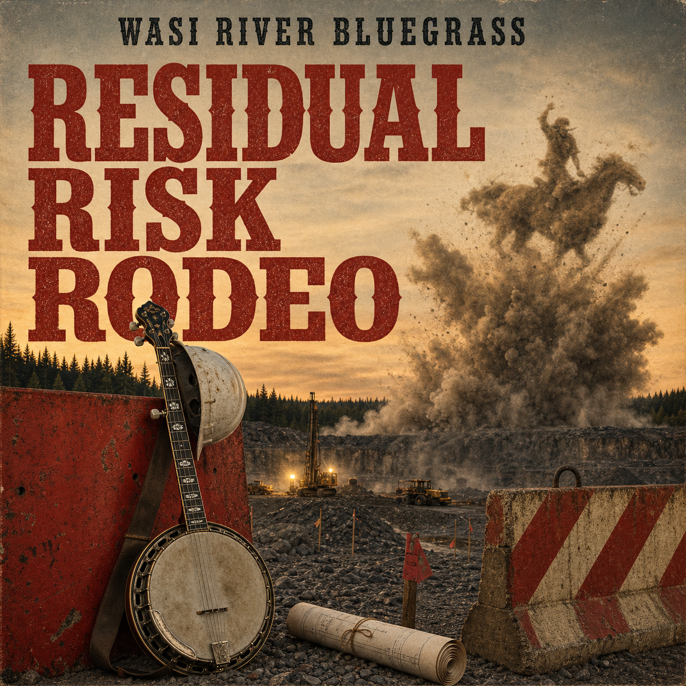

# Residual Risk Rodeo

## Open-source engineered bluegrass

Residual Risk Rodeo is a concept album by Wasi River Bluegrass about hazards, controls, near misses, corrective actions, and the emotional life of work—performed somewhere between bluegrass, industrial percussion, gospel, and a very persistent banjo.

The project treats an album like an engineered system: define the brief, record decisions, test variations, preserve the evidence, and make the process inspectable.

## Start here

- [Listen and see the tracklist](TRACKLIST.md)
- [Read the album concept](TRACK-SLATE.md)
- [Browse the production process](PROCESS.md)
- [View the cover artwork](COVER.png)

## Listen

- [Residual Risk Rodeo public Suno playlist](https://suno.com/playlist/15603b83-a0dc-4bc9-bc27-f593b971e1fc)
- [Cover artwork](COVER.png)

## Tracklist

1. Residual Risk Rodeo
2. The Banjo Is Not the Hazard
3. Corrective Action Boogie
4. Near Miss at the Gravel Pit
5. Blast Beat Evacuation Drill
6. Hierarchy of Controls
7. Lockout / Tagout / Let It Roll
8. The Observer Signs the Permit
9. PPE for the Soul
10. Incident Investigation at Mile 46
11. Banjo as Control
12. Closeout Meeting / River Still Running

## Repository map

- `TRACK-SLATE.md`, `SONIC-BIBLE.md` — concept, narrative structure, and sonic direction
- `ALBUM-DIRECTION.md`, `TRACK-PROMPT-TEMPLATE.md` — reusable creative prompts
- `01-*.md` through `14-*.md` — track production briefs and experiments
- `TRACKLIST.md`, `ALBUM-METADATA-DRAFT.md` — public release notes
- `COVER.png` — approved project artwork

## Working principles

- Keep the creative brief visible.
- Preserve experiments and explain selections.
- Use concrete places, tools, weather, machinery, and human voices.
- Let humour carry real emotional and safety content.
- Treat uncertainty as part of the record, not something to hide.

## Status

The twelve-track public playlist is the current listening canon. This repository is the public documentation and creative-process edition; candidate audio, private notes, and deployment archives remain outside it.

## Contributions

Ideas, prompt experiments, arrangement notes, and documentation improvements are welcome. See [CONTRIBUTING.md](CONTRIBUTING.md).

## Rights and attribution

See [LICENSE.md](LICENSE.md) before reusing the music, artwork, lyrics, or project materials. Links to third-party services are provided for listening and provenance.
